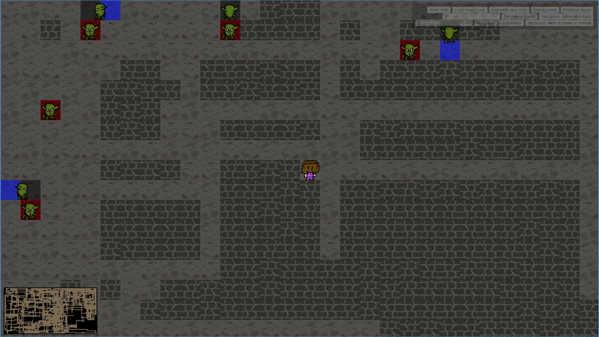

# Rogue like game maded in Typescript

A simple rogue like game maded entire in typescript.

# Todo

* A way out of the cave
* Enemies system
    * Enemy view system (Partially done. The enemies still have some struggles that I dont know if worth fix it. It cause some immersion the way it is righ now)
* Other objects in game
* Inventory system
* Loot system loop
* Hungry and Thirst system
* Stamine system
* Add sound effect
* Objects with light

# References

* [parallelrealities](https://parallelrealities.co.uk/)
* [Devlog](https://www.youtube.com/playlist?list=PLIOqXyLE0y8A)
